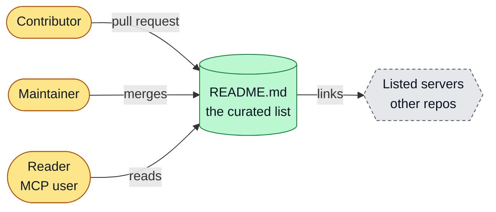
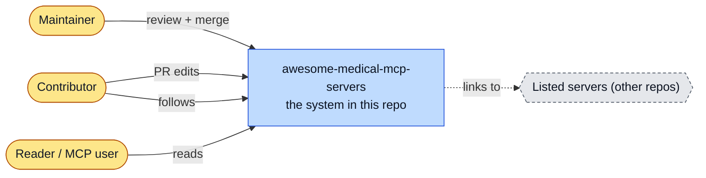
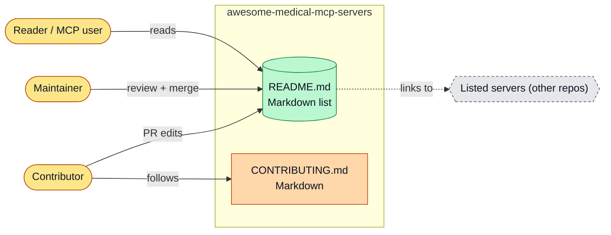
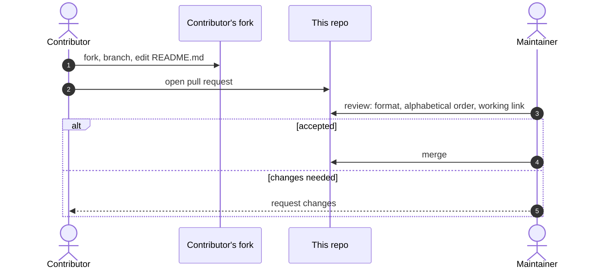
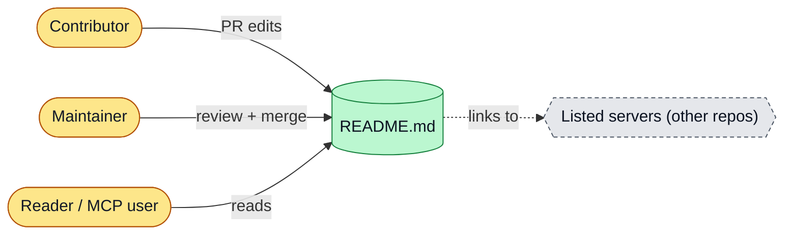

# awesome-medical-mcp-servers: architecture

<!-- arch-kit:generated -->

> Whiteboard-level structure: what systems exist, what they talk to, and when they run. Evidence-backed; every box below maps to a path listed in [Evidence](#10-evidence).
> Generated by the ArchDocs kit from repo commit `6eb634d41e`. Diagram sources: [`architecture/*.mmd`](architecture/). Hi-res renders sit next to each source.

## 1. Purpose

This repository is a fork of a curated list of medical Model Context Protocol (MCP) servers. It has no code and no automation. The product is one file, `README.md`, a hand-sorted list of links to other people's servers for PubMed, DICOM, FHIR and similar tools. Changes arrive as pull requests that edit that file; a maintainer reviews and merges.

## 2. Whiteboard view

Five boxes. There is no runtime: the list is the system.

Hi-res: [SVG](architecture/whiteboard.svg) · [PNG 3x](architecture/whiteboard@3x.png) · [dark SVG](architecture/whiteboard.dark.svg) · [dark PNG 3x](architecture/whiteboard.dark@3x.png)

Explorable version (Archify, standalone HTML, download and open locally): [`architecture/awesome-medical-mcp-servers.archify.html`](architecture/awesome-medical-mcp-servers.archify.html)

## 3. System context (C4 level 1)

Who and what touches the system from outside.

Hi-res: [SVG](architecture/context.svg) · [PNG 3x](architecture/context@3x.png)

## 4. Containers and components (C4 level 2)

The parts that run or hold data inside the repo's system boundary.

Hi-res: [SVG](architecture/containers.svg) · [PNG 3x](architecture/containers@3x.png)

| Container | Kind | Tech | What it does | Evidence |
|---|---|---|---|---|
| README.md | store | Markdown list | Servers section: one server per line, alphabetical within a category. | [`README.md#L19-L33`](../README.md#L19-L33), [`CONTRIBUTING.md#L38-L44`](../CONTRIBUTING.md#L38-L44) |
| CONTRIBUTING.md | doc | Markdown | Fork, branch, edit README, open a PR. | [`CONTRIBUTING.md#L5-L35`](../CONTRIBUTING.md#L5-L35) |

## 5. Key runtime sequences

### 5.1 Adding a server to the list

Hi-res: [SVG](architecture/sequence-1.svg) · [PNG 3x](architecture/sequence-1@3x.png)

## 6. Data flow and stores

How data moves between components and where it rests.

Hi-res: [SVG](architecture/dataflow.svg) · [PNG 3x](architecture/dataflow@3x.png)

## 7. Deployment and runtime topology

Nothing is deployed. The list is rendered by GitHub from `README.md` on the default branch. There is no CI, no schedule and no link checker, so dead links are found by readers or maintainers.

## 8. Failure modes and how to see them

| Failure | What the user sees | How to see it | Evidence |
|---|---|---|---|
| Listed server repo is deleted or private | Dead link stays in the list | Reader report or manual check (git history shows an earlier removal of a private-repo entry) | [`README.md#L21-L33`](../README.md#L21-L33) |
| Entries out of alphabetical order or wrong format | List drifts from the contributing rules | Maintainer review only; no automation | [`CONTRIBUTING.md#L38-L44`](../CONTRIBUTING.md#L38-L44) |

## 9. State machine

No state machine in this repo: it is a static list.

## 10. Evidence

Every path below exists at the pinned commit; links are relative to `docs/`.

| Path | Why it matters |
|---|---|
| [`README.md#L19-L33`](../README.md#L19-L33) | The Servers list. |
| [`CONTRIBUTING.md`](../CONTRIBUTING.md) | Fork, branch, edit, PR workflow and list rules. |
| [`LICENSE`](../LICENSE) | License file inherited from upstream. |

Graphify (local AST, no LLM) read this repo: 10 nodes, 8 edges, 2 communities. Most connected: `Awesome-Medical-MCP-Servers ` (5), `Contributing to Awesome MCP Servers` (3), `How to Contribute` (1), `Guidelines` (1), `What is MCP?` (1).

- Report: [`architecture/graphify/GRAPH_REPORT.md`](architecture/graphify/GRAPH_REPORT.md)
- Interactive graph: [`architecture/graphify/graph.html`](architecture/graphify/graph.html) (27 KB, download and open locally)
